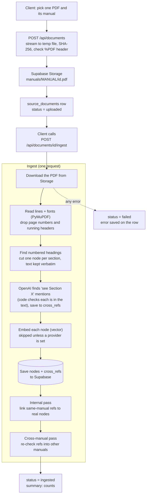

# Ingestion flow

One PDF at a time: save it to the Supabase bucket, then cut it into chunks and save those in the database.

## How headings are found

The PDF is read page by page. For each page the planner (OpenAI, or the regex fallback) is shown:

| Block | Lines | Numbered? | Purpose |
| --- | --- | --- | --- |
| End of the previous page | last `CHUNK_CONTEXT_LINES` (default 6) | no | context only: is the page continuing a list or a table? |
| The page itself | all | yes | the only place a heading may start |
| Start of the next page | first `CHUNK_CONTEXT_LINES` | yes, continuing the page's numbers | a heading that starts at the bottom of the page can run into these |

The planner answers with line numbers only (where each heading starts and how many lines it takes), and the code cuts the
PDF's own lines there. A node runs until the next heading, even across pages. A heading cut by a page break is joined
from both pages; the lines it took are removed from the next page before that page is planned. The code drops or trims
any answer it cannot trust: a start outside the page, an overlap, a section number that is not in the heading text, or
heading lines that are not set in the same style as the first one.

## Cross-reference statuses

| Status | Meaning |
| --- | --- |
| `unresolved` | Points into the same manual and the internal pass did not find the section. So do tables and figures that were not captured. Also: points at another manual that **is** ingested but has no such section. |
| `awaiting_cross` | Points at another manual that is **not ingested yet** (e.g. PPM citing "Section 2.6 of the CADD Users Manual"). |
| `resolved` | Linked to a real node, or to a captured figure (`target_figure_id`) or table (`target_table_id`). `resolved_by` records which pass did it. |

The cross-manual pass runs on every ingest and every delete, over the current ingested document of each manual, and
recomputes each cross-manual reference from scratch. Upload order does not matter, and replacing or deleting a manual
puts references to it back to `awaiting_cross`.

## Figures

`ingestion/figures.py` runs on the same PDF during ingest. A block starting with `Figure N-N` is a caption when graphics
(embedded images or vector drawings) sit within 60 points above or below it and the words after the number do not start
in lower case ("Figure 2-7 shows..." is a sentence). The drawing plus the caption is rendered to a PNG
(`FIGURE_DPI`, default 150) and saved in the bucket at `figures/<document id>/<label>.png`; a row in `figures` holds the
label, caption, page, owning section and image path. The first usable caption of a number wins.

The internal and cross-manual passes link a `... Figure N-N` reference to the figure with that number. Endpoints:
`GET /api/figures?document_id=` and `GET /api/figures/{id}/image`. A failure while capturing figures does not fail the
ingest; it is logged and shown as `figures_error` in the document summary. Run `sql/002_figures.sql` on an existing database.

## Tables

`ingestion/tables.py` runs on the same PDF during ingest. A line starting with `Table N` is a caption when a **ruled** grid
(PyMuPDF's table finder, so it needs ruling lines) sits within 60 points of it, overlapping it horizontally, with at
least two non-empty rows, and the words after the number do not start in lower case ("Table 2.4 lists..." is a
sentence). The cells are saved as `rows` in `manual_tables`, and the grid plus the caption is rendered to a PNG
(`TABLE_DPI`, default 150) in the bucket at `tables/<document id>/<label>.png`. The table's text also stays in its
node: this record is only what a reference can point at.

The internal and cross-manual passes link a `... Table N` reference to the table with that number. Endpoints:
`GET /api/tables?document_id=` (no cells), `GET /api/tables/{id}` (with cells) and `GET /api/tables/{id}/image`. A
failure while capturing tables does not fail the ingest; it is logged and shown as `tables_error` in the summary.
Run `sql/005_tables.sql` on an existing database **before** the next ingest, then ingest each document again.

Limits: a table with no ruling lines (many Caltrans tables have horizontal rules only) is not captured, and a reference
to it stays `unresolved`. Only the part of a table on its caption's page is kept. A reference to a family of tables
("Table 202.2" for 202.2A to 202.2E) does not match any of them.

## Retrieval

The chat Lambda (`infra/lambdas/chat/retrieval.py`) runs three searches and merges them, so a question can be worded any way:

| Search | Finds | SQL |
| --- | --- | --- |
| meaning | paraphrases: nearest section vectors by cosine | `match_nodes` (`sql/003_match_nodes.sql`) |
| keywords | the question's words in the text, rare words counting more, extra for an exact phrase | `match_nodes_text` (`sql/004_hybrid_search.sql`) |
| heading | a section number (`1-1.8`) or a heading typed in full or in part (`§1-1.8 Content and Development of Electronic Files`) | `match_nodes_title` (`sql/004_hybrid_search.sql`) |

The lists are merged with reciprocal rank fusion (equal scores share a rank; an exact heading or number is pinned first;
only keyword matches near the best one count). Each hit says which searches found it (`matchedBy`). If `004` has not been
run, keywords and headings are skipped and search is meaning-only. Chat answers only from relevant hits: close in meaning,
heading named, or the words present; otherwise it says the manuals do not cover the question. Conversational words ("I want to know the article ...") are ignored by the keyword search. A "where / which section" question searches wider (`CHAT_LOCATE_TOP_K`) and asks the model to list every place; a long section is shortened to its start plus the passages that hold the question's words; only the sources the answer cites are returned.

With `expand` each hit also carries what its resolved cross-references lead to: `mentions` (sections its text points at),
`mentioned_by` (sections pointing at it), and figures (`in_section`, `mentioned`). A linked section that is itself a hit
has `alsoHit: true`. Unresolved references are not followed.

## Failure handling

An exception during ingest marks the document `failed` with the reason in `error` (a PDF with no numbered headings
gives a 422 with a plain explanation). The file stays in the bucket. Run ingest again, from the UI "Retry ingest",
after fixing the cause. Re-running replaces the document's chunks, never duplicates them.

## Not built yet

- Tagging (classification, applicability conditions, exceptions). The `node_conditions` table and the tagging columns on `nodes` exist; nothing fills them.
- Search and the explicit "not covered" answer.
- Tables without ruling lines, tables that run over several pages, and reading a figure's or table's content with a vision model.
- Tables and figures in search and chat answers (they are only linked from references so far).
- Requirement class from formatting (boldface / underlined).
